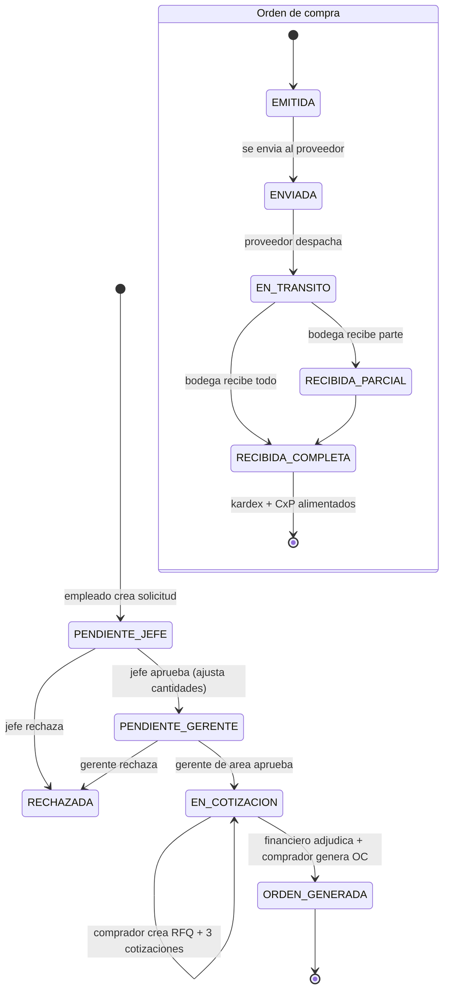

# Flujo del sistema y modelo de roles — Gestión de Compras

## 1. El flujo, paso a paso, y qué lo cubre en el sistema

> Sistema para gestionar todas las compras de la empresa.

| # | Paso del negocio | Rol responsable | En el sistema | Estado que deja |
|---|---|---|---|---|
| 1 | **Ingresar solicitud de compra** (qué, cuánto, para cuándo, justificación) | Empleado solicitante | Pantalla *Solicitudes de compra → Nuevo*. `POST /api/com/solicitudes` (cabecera + renglones). Editable con **`PUT /api/com/solicitudes/:id`** (acción *Editar*) **solo mientras está `PENDIENTE_JEFE`**, con bloqueo optimista. | `PENDIENTE_JEFE` |
| 2 | **Jefe inmediato**: deniega, autoriza **o modifica cantidades** | Jefe inmediato | Acción *Aprobar* / *Rechazar* en la fila. Al aprobar puede enviar `ajustes` (cantidad autorizada por renglón). Registra fila en `COM_WORKFLOW_APROBACION`. | `PENDIENTE_GERENTE` o `RECHAZADA` |
| 3 | **Gerente del área**: deniega o autoriza | Gerente de área | Segunda *Aprobar* / *Rechazar*. | `EN_COTIZACION` o `RECHAZADA` |
| 4 | **Depto. de Compras solicita 3 cotizaciones a proveedores** | Comprador | *RFQ → Nuevo* (solicitud + ≥3 proveedores invitados). La fecha límite se corrige con **`PUT /api/com/rfq/:id`** (acción *Editar*) **solo mientras está `ABIERTO`**. Luego *Cotizaciones → Nuevo* (una por proveedor, con precios por renglón). | RFQ `ABIERTO` → `CERRADO`; cotizaciones registradas |
| 5 | **Gerente financiero selecciona la mejor cotización** | Gerente financiero | Pantalla *Comparativo de cotizaciones*: ve las cotizaciones lado a lado, marca criterios, pulsa *Adjudicar*. Puede exportar el PDF y ver el PDF de referencia adjunto a cada cotización. El comprador arma el RFQ y las cotizaciones (paso 4) con el botón **"Iniciar cotización"** de la fila de la solicitud (asistente guiado: `AsistenteCotizacion.tsx`, encadena RFQ→cotización por proveedor→deja el comparativo listo); el financiero entra después a decidir. | Línea de cotización `ADJUDICADO='S'` (des-adjudica las demás) |
| 6 | **La cotización seleccionada se convierte en orden de compra y se envía al proveedor** | Comprador / Gerente financiero | *Órdenes de compra → Nuevo* con la solicitud origen (o el botón "Generar orden de compra" dentro del propio Comparativo); el precio se toma de la cotización adjudicada (patrón Strategy). Luego *Cambiar estado → ENVIADA*. | Solicitud `ORDEN_GENERADA`; OC `EMITIDA → ENVIADA` |
| 7 | **Proveedor procede con el despacho** | (externo; se marca al recibir aviso) | *Cambiar estado → EN_TRANSITO*. | OC `EN_TRANSITO` |
| 8 | **La mercadería aumenta el inventario y la factura se alimenta en CxP** | Bodega | *Recepciones → Nuevo* (recibido / rechazado por renglón). Dispara el evento `RecepcionRegistrada` → dos suscriptores automáticos: **(a)** alta en `INV_KARDEX_MOVIMIENTO` + recálculo de costo promedio ponderado + `INV_EXISTENCIA_BODEGA`; **(b)** `CXP_FACTURA_PROVEEDOR` en borrador con saldo pendiente. | OC `RECIBIDA_PARCIAL / RECIBIDA_COMPLETA`; recepción `ALIMENTADO_CXP` |

Además: devoluciones al proveedor (`COM_DEVOLUCION_PROVEEDOR`), seguimiento y
excepciones de la OC, historial de precios por proveedor, dashboard.

### Diagrama del ciclo



---

## 2. Roles: quién ve y hace qué

Implementado con las tablas `SEG_` del esquema (`SEG_ROL`, `SEG_PERMISO`,
`SEG_ROL_PERMISO`, `SEG_USUARIO_ROL`, `SEG_USUARIO`).

- Al **iniciar sesión** (`POST /api/auth/login`) el backend resuelve
  usuario → roles → permisos y emite un **JWT** con la lista de permisos.
- Cada **endpoint** exige el permiso que le corresponde (`authGuard`).
- El **frontend** guarda el token, pide `GET /api/auth/me`, y **oculta del menú
  y de las acciones** lo que el rol no puede hacer. Cada departamento entra y
  ve solo lo suyo.

### Catálogo de permisos (módulo `COMPRAS`)

| Código | Qué habilita |
|---|---|
| `COMPRAS_SOLICITUD_CREAR` | Crear solicitudes de compra |
| `COMPRAS_SOLICITUD_VER` | Ver solicitudes |
| `COMPRAS_SOLICITUD_APROBAR_JEFE` | Aprobar/rechazar/ajustar en `PENDIENTE_JEFE` |
| `COMPRAS_SOLICITUD_APROBAR_GERENTE` | Aprobar/rechazar en `PENDIENTE_GERENTE` |
| `COMPRAS_RFQ_GESTIONAR` | Crear / cerrar RFQ, invitar proveedores — y verlas |
| `COMPRAS_COTIZACION_GESTIONAR` | Registrar cotizaciones de proveedor — y verlas |
| `COMPRAS_COTIZACION_ADJUDICAR` | Adjudicar cotización, registrar criterios — y ver cotizaciones |
| `COMPRAS_OC_GESTIONAR` | Generar OC, cambiar su estado — y verla |
| `COMPRAS_RECEPCION_GESTIONAR` | Registrar recepciones — y verlas |
| `COMPRAS_DEVOLUCION_GESTIONAR` | Registrar devoluciones a proveedor — y verlas |
| `COMPRAS_CATALOGO_VER` | Ver catálogos (proveedores, monedas, …) |
| `COMPRAS_CATALOGO_EDITAR` | Editar catálogos **operativos**: proveedores, artículo-proveedor, acuerdos, condiciones de pago, términos, grupos, categorías, centros de costo, seguimiento/excepciones de OC |
| `COMPRAS_CATALOGO_ADMIN` | Editar el catálogo de **monedas** — función de Finanzas, no de Compras |
| `COMPRAS_ANALISIS_VER` | Dashboard, comparativo, historial de precios |
| `COMPRAS_REPORTE_EVALUACION` / `_GASTO` / `_ENTREGAS` / `_DESEMPENO` / `_RIESGO` | Un reporte cada uno (ver tabla de abajo) |
| `*` | Todo (solo `ADMIN_COMPRAS`) |

**Principio rector, explícito y definitivo** (decisión del usuario tras
cuestionar el diseño: *"por que tiene que ver alguien con un rol a algo que
no tiene acceso, si no puede editarlo o manipularlo, para que lo ve"* —
eligió, entre varias opciones, "quitar toda lectura sin escritura"): **un rol
solo ve un recurso si también puede gestionarlo/accionarlo.** No existen
permisos de "solo observación" por recurso — no hay `RFQ_VER`, `OC_VER`, etc.
Cada `*_GESTIONAR`/`*_ADJUDICAR` concede lectura **y** escritura de su propio
recurso, para su propio titular, punto. Dos excepciones, preexistentes y
deliberadas, porque no son "ver el trabajo ajeno" sino una necesidad
funcional propia de quien las tiene:
- `SOLICITUD_VER` — universal: cualquier rol de la cadena de aprobación
  necesita comprobar si tiene algo pendiente de su turno.
- `ANALISIS_VER` — gatea **vistas agregadas** (Dashboard, Comparativo,
  Historial de precios, Reportes), no los documentos transaccionales crudos
  que esas vistas resumen.

Bodega, que gestiona Recepciones pero no Órdenes de compra, no navega el
listado general de OC — elige la orden a recibir desde un endpoint de
referencia acotado a su propio formulario, `GET /api/com/ref/oc/receptibles`
(gateado por `RECEPCION_GESTIONAR`, el permiso que sí tiene), no por acceso
general al documento OC.

> **Las tablas de auditoría del propio flujo** (`COM_WORKFLOW_APROBACION` —
> quién aprobó qué — y `COM_COMPARATIVO_COTIZACIONES` — criterios de
> adjudicación) **no se editan vía API para ningún rol, ni siquiera
> `ADMIN_COMPRAS`**: solo se leen (`CATALOGO_VER`). Se llenan exclusivamente
> como efecto de las transacciones de negocio que ya las escriben
> (`SolicitudCompraService.registrarWorkflow`,
> `ComparativoService.registrarCriterio`) — exponer un CRUD genérico encima
> permitiría reescribir o borrar el historial de aprobaciones por fuera de
> esa lógica, y rompería la integridad del propio rastro de auditoría.

### Roles y sus permisos

| Rol | Quién es | Permisos |
|---|---|---|
| **SOLICITANTE** | Cualquier empleado que pide una compra | `SOLICITUD_CREAR`, `SOLICITUD_VER`, `CATALOGO_VER`, `ANALISIS_VER` |
| **JEFE_INMEDIATO** | Jefe directo del solicitante | lo de SOLICITANTE + `SOLICITUD_APROBAR_JEFE` — **solo sobre las solicitudes de sus reportes directos** |
| **GERENTE_AREA** | Gerente del área que compra | `SOLICITUD_VER`, `SOLICITUD_APROBAR_GERENTE`, `CATALOGO_VER`, `ANALISIS_VER` — aprueba **solo sobre las solicitudes de su departamento**; no gestiona RFQ/cotización/OC/recepción/devolución, así que **no las ve** (solo el agregado vía `ANALISIS_VER`: Dashboard, Comparativo, Historial, Reportes) |
| **COMPRADOR** | Departamento de Compras | `SOLICITUD_VER`, `RFQ_GESTIONAR`, `COTIZACION_GESTIONAR`, `OC_GESTIONAR`, `CATALOGO_VER`, `CATALOGO_EDITAR`, `ANALISIS_VER` — arma el RFQ y registra las cotizaciones (con el asistente guiado, `AsistenteCotizacion.tsx`) y genera la OC ya adjudicada; **no adjudica, no aprueba solicitudes, no administra monedas, no gestiona ni ve Recepciones/Devoluciones** (no son suyas) |
| **GERENTE_FINANCIERO** | Finanzas | `SOLICITUD_VER`, `COTIZACION_ADJUDICAR`, `OC_GESTIONAR`, `CATALOGO_VER`, `CATALOGO_EDITAR`, `CATALOGO_ADMIN`, `ANALISIS_VER` — **adjudica y autoriza la OC; no crea RFQ ni cotizaciones, no ve Recepciones/Devoluciones**; administra el catálogo de monedas (función de Finanzas) |
| **BODEGA** | Recepción de mercadería | `RECEPCION_GESTIONAR`, `DEVOLUCION_GESTIONAR`, `CATALOGO_VER` — elige la OC a recibir desde el endpoint de referencia acotado de su propio formulario (`/api/com/ref/oc/receptibles`), **no navega el documento OC**; **nada de solicitudes/RFQ/cotización ni edición de catálogos** |
| **AUDITOR** | Auditoría / control interno | `SOLICITUD_VER`, `CATALOGO_VER`, `ANALISIS_VER` — ve si hay solicitudes pendientes y el agregado analítico (Dashboard/Comparativo/Historial/Reportes), **cero permisos de escritura y cero acceso a RFQ/cotización/OC/recepción/devolución como documentos**: no los gestiona, no los ve |
| **ADMIN_COMPRAS** | Administrador del módulo (cuenta técnica, no una gerencia) | `*` — pero ni siquiera el comodín le da escritura sobre las tablas de auditoría del flujo (ver nota arriba: esas rutas de escritura no existen) |

### Jerarquía de aprobación y autorización

```
Solicitante  --crea-->  PENDIENTE_JEFE
   Jefe inmediato (de su equipo)   --aprueba/ajusta cant.-->  PENDIENTE_GERENTE   |  --rechaza--> RECHAZADA
   Gerente de área (de su depto)   --aprueba-->  EN_COTIZACION                    |  --rechaza--> RECHAZADA
Comprador   --RFQ (≥3 prov.) + registra cotizaciones-->  comparativo listo
Gerente financiero   --adjudica la mejor oferta-->  Comprador genera la OC  -->  ORDEN_GENERADA
   (la OC nace EMITIDA; comprador/financiero la mueven ENVIADA→EN_TRANSITO)
Bodega   --registra la recepción-->  kardex + CxP  -->  RECIBIDA_PARCIAL/COMPLETA
```

- El **alcance por departamento/equipo** se aplica tanto a la **lectura** (un
  jefe/gerente solo lista y abre lo de su ámbito) como a la **acción**: un jefe
  que intente aprobar una solicitud de otro equipo recibe **403**
  (`SolicitudCompraService` valida `empleadosEnAlcance` antes de la transición).
- **`GET /api/com/notificaciones`** entrega la *bandeja de pendientes* de cada
  rol, derivada del estado del flujo (no hay tabla de notificaciones):
  jefe → `PENDIENTE_JEFE` de su equipo · gerente → `PENDIENTE_GERENTE` de su área ·
  comprador → `EN_COTIZACION` sin RFQ · financiero → comparativos por adjudicar ·
  bodega → OC `ENVIADA`/`EN_TRANSITO` por recibir. El frontend la muestra en la
  campana de la topbar (badge + panel navegable).

### Qué ve cada rol en el menú

| Sección del menú | SOLICITANTE | JEFE | GERENTE_AREA | COMPRADOR | FINANCIERO | BODEGA | AUDITOR | ADMIN |
|---|:-:|:-:|:-:|:-:|:-:|:-:|:-:|:-:|
| Dashboard | ✔ | ✔ | ✔ | ✔ | ✔ | – | ✔ | ✔ |
| Catálogos (ver) | ✔ | ✔ | ✔ | ✔ | ✔ | ✔ | ✔ | ✔ |
| Catálogos (editar) | – | – | – | ✔ | ✔ | – | – | ✔ |
| Monedas (administrar) | – | – | – | – | ✔ | – | – | ✔ |
| Solicitudes de compra | ✔ | ✔ | ✔ | ✔ | ✔ | – | ✔ | ✔ |
| RFQ / Invitaciones | – | – | – | ✔ | – | – | – | ✔ |
| Cotizaciones | – | – | – | ✔ | ✔ | – | – | ✔ |
| Órdenes de compra | – | – | – | ✔ | ✔ | – | – | ✔ |
| Recepciones / Devoluciones | – | – | – | – | – | ✔ | – | ✔ |
| Comparativo / Historial / Reportes | ✔ | ✔ | ✔ | ✔ | ✔ | – | ✔ | ✔ |

Sin celdas "✔ lectura": no existen permisos de solo observación por
documento. Quien no gestiona un recurso, no lo ve — ni el documento ni su
detalle. Bodega, que no ve "Órdenes de compra" como sección de menú, igual
puede recibir mercadería: su formulario de Recepción trae la OC a recibir
desde `/api/com/ref/oc/receptibles`, sin necesitar el documento completo.

> El menú se filtra por permiso de **gestión** de cada documento — y el
> backend impone exactamente lo mismo en la API (misma guarda, sin
> permisos de solo lectura adicionales): cada rol solo lista/abre los
> documentos que gestiona. `auditor` conserva Solicitudes (`SOLICITUD_VER`,
> universal) y Comparativo/Historial/Reportes (`ANALISIS_VER`, agregados),
> pero no la plomería operativa (RFQ/Cotizaciones/OC/Recepciones/
> Devoluciones) porque no gestiona ninguna. La escritura siempre está
> bloqueada por su propio permiso de gestión.
> **Ya no existe el atajo `X-Dev-User` por defecto**: sin login real (JWT) el
> backend responde 401 y la app muestra el LoginScreen; el atajo solo revive con
> `APP_DEV_AUTH=1` en entorno no productivo (dev/tests).

### Dashboard y Reportes por rol (qué decide cada uno)

**Cada reporte tiene su propio permiso** (`COMPRAS_REPORTE_*`), validado en el
backend (JSON y PDF) y en el menú. Antes los cinco colgaban de `ANALISIS_VER` y
todo rol con análisis los veía todos; ahora `ANALISIS_VER` solo cubre Dashboard,
Comparativo e Historial de precios. Criterio: *un área ve un reporte solo si
con él toma una decisión propia.*

| Reporte (permiso) | Decisión que soporta | Compras | Finanzas | Auditoría | Gerente área / Jefe / Solicitante / Bodega |
|---|---|:-:|:-:|:-:|:-:|
| Evaluación de proveedores (`REPORTE_EVALUACION`) | A quién comprarle: descuento, entrega, envío | ✔ | – | – | – |
| Gasto por proveedor (`REPORTE_GASTO`) + resumen financiero del Dashboard | Cuánto se gasta y con quién se concentra | – | ✔ | ✔ | – |
| OC pendientes de recibir (`REPORTE_ENTREGAS`) | Seguimiento de entregas / compromisos de caja | ✔ | ✔ | – | – |
| Desempeño de proveedores (`REPORTE_DESEMPENO`) | ¿Cumplen? Entrega y rechazo | ✔ | – | ✔ | – |
| Riesgo de proveedores (`REPORTE_RIESGO`) | De quién es riesgoso depender | – | ✔ | ✔ | – |

Cada área recibe 3 de los 5 reportes, y ninguna recibe el mismo conjunto:
Compras = *operar* (comprar, recibir, evaluar cumplimiento); Finanzas =
*dinero* (gasto, caja, dependencia); Auditoría = *control* (gasto, cumplimiento,
riesgo). `ADMIN_COMPRAS` (`*`) ve todos.

Gerente de área, jefe, solicitante y bodega **no tienen reportes** (no existe la
opción en el menú y la API responde 403): su decisión es aprobar o recibir, y
eso lo resuelven con sus bandejas y el Dashboard.

Dashboard por rol (`frontend/src/modules/DashboardRol.tsx`; el perfil se deriva
de los permisos de gestión en `perfilAnalitico.ts` y solo ordena/enfoca):

| Perfil | Dashboard (cada panel usa solo el reporte que ese rol tiene) |
|---|---|
| Comprador | «A quién conviene comprarle» (mayor descuento, entrega más rápida, envío gratuito) + entregas atrasadas |
| Financiero | Concentración del gasto por proveedor + panorama de gasto/ahorro |
| Auditor | «Proveedores a vigilar» (riesgo medio/alto) + panorama financiero |
| Gerente de área / Jefe | Sus decisiones pendientes de aprobación |
| Solicitante | Sus solicitudes |

Pruebas: `backend/tests/reportesRbac.int.test.ts` (rol real × reporte × JSON/PDF)
y `frontend/src/core/auth/perfilAnalitico.test.ts`.

**Evaluación de proveedores** (`GET /api/com/reportes/evaluacion-proveedores`,
+ `/pdf`): sobre las OC vigentes calcula por proveedor descuento ponderado por
monto, ahorro en GTQ, días de entrega reales (emisión → última recepción),
% de OC a tiempo, % de rechazo, % de OC con envío gratuito y flete promedio, y
un score 0-100 por *enfoque* (`equilibrado`, `ahorro`, `rapidez`, `calidad`).
Filtros: `desde`, `hasta`, `idCategoria` (categoría de artículo), `minOrdenes`
(por defecto 2 en la UI), `prioridad`, `soloEnvioGratis`.

- «Quién destaca» **no nombra ganador** si todos empatan, si hay un solo
  proveedor con dato, o si el mejor descuento/envío gratis es 0: no inventa
  diferencias.
- **Envío gratuito** requiere el dato nuevo `COM_ORDEN_COMPRA.COSTO_ENVIO`
  (`NULL` = no registrado, `0` = gratis, `> 0` = flete en la moneda de la OC).
  Se captura en el formulario de la OC (campo *Costo de envío*) y se migra solo
  (`ensureCostoEnvio` en `backend/scripts/deploy.ts`, también en
  `SCRIPT_DDL.sql`). Las OC anteriores quedan en `NULL` («s/d»).

### Usuarios de demostración (seed `database/dml/02_seg_rbac.sql`)

Se inicia sesión con solo el usuario (sin contraseña, entorno de desarrollo).
En la pantalla de login hay un selector.

| Usuario | Empleado | Rol |
|---|---|---|
| `solicitante` | María López | SOLICITANTE |
| `jefe` | Jorge Ramírez | JEFE_INMEDIATO |
| `gerente` | Ana Castillo | GERENTE_AREA |
| `comprador` | Sofía Herrera | COMPRADOR |
| `financiero` | Ricardo Morales | GERENTE_FINANCIERO |
| `bodega` | Luis González | BODEGA |
| `auditor` | Patricia Núñez | AUDITOR |
| `admin` | Diego Vargas | ADMIN_COMPRAS |

`JEFE_INMEDIATO` ya incluye `SOLICITUD_CREAR` en sus permisos, así que el jefe
también puede ingresar solicitudes sin necesitar un segundo rol.

Contraseña de todos los usuarios demo: **`compras.demo`**.

> **Fase 6 — ya implementado:** contraseña real scrypt + bloqueo por intentos +
> bitácora `SEG_BITACORA_ACCESO` (6.1); filtro por **departamento/equipo** en
> lectura y en la acción de aprobación (6.2 + endurecimiento RBAC); catálogos
> sensibles separados a `CATALOGO_ADMIN` (solo ADMIN); campana de **pendientes**
> por rol (`GET /api/com/notificaciones`). Ver `docs/02-ESTADO-Y-CONTINUIDAD.md`.
